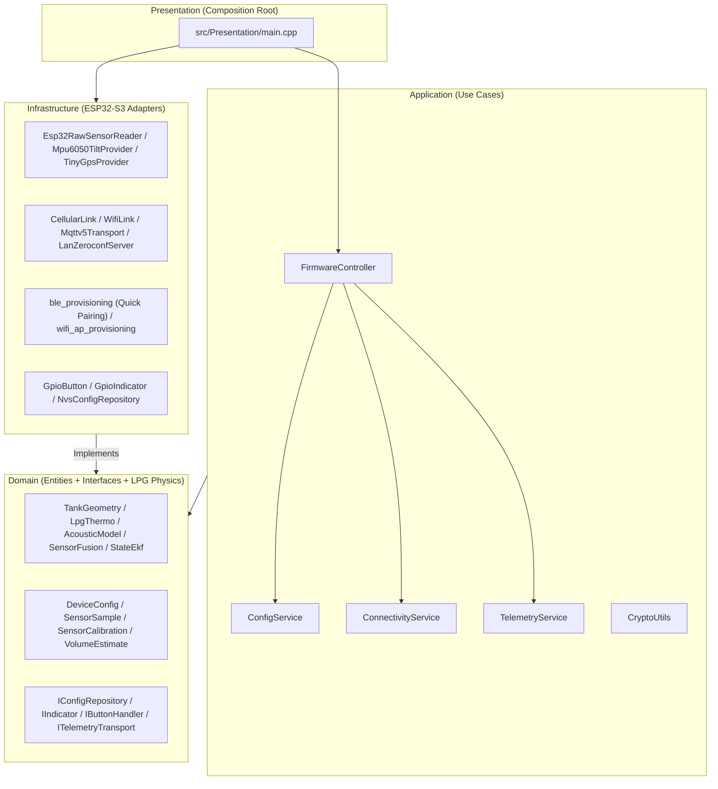

# GLP_Presure — Clean Architecture LPG Telemetry Firmware (ESP32-S3)

**Stationary LPG Tank Level, Pressure, and Temperature Telemetry with Dual Redundant Connectivity (Wi-Fi + LTE SIM7600), Native MQTT 5.0 over TLS, Quick Pairing (BLE GATT + SmartConfig), Local LAN HTTP Diagnostics, and Secure OTA Updates**

[](https://www.espressif.com/en/products/socs/esp32-s3)
[](https://en.cppreference.com/w/cpp/17)
[](https://mqtt.org)
[](https://github.com/h2zero/NimBLE-Arduino)
[](#system-architecture-clean-architecture)
[](https://platformio.org)
[](https://cmake.org)

---

## Table of Contents

- [Overview](#overview)
- [Key Features](#key-features)
- [Added Functions & Modules](#added-functions--modules)
- [System Architecture (Clean Architecture)](#system-architecture-clean-architecture)
- [GPIO Pinout (ESP32-S3)](#gpio-pinout-esp32-s3)
- [2-Stage Pairing Workflow (Quick Pairing + SoftAP)](#2-stage-pairing-workflow-quick-pairing--softap)
- [Local LAN HTTP Diagnostics (`/zeroconf/*`) & mDNS](#local-lan-http-diagnostics-zeroconf--mdns)
- [Build & Host Unit Testing](#build--host-unit-testing)

---

## Overview

**GLP_Presure** is an industrial telemetry firmware for stationary Liquefied Petroleum Gas (**LPG**) tanks, engineered in **Clean Architecture** on the **ESP32-S3** (`esp32-s3-devkitc-1`). It combines pure thermodynamic, acoustic, and geometric domain models (`Domain/Services/`), redundant **Wi-Fi + 4G LTE (SIM7600)** connectivity with **MQTT 5.0 (`ESP32_MQTTv5` + `MQTTOTAv5`)**, a 2-stage pairing workflow (**Quick Pairing BLE GATT `GLP-<DeviceID>` + SmartConfig** and **SoftAP `GLP-CONFIG-<DeviceID>`**), and a local **HTTP Zeroconf Server (`:8081`)** with `AES-128-CBC` encryption.

---

## Key Features

| Feature | Description |
|---|---|
| **Clean Architecture** | 4 decoupled layers (`Domain`, `Application`, `Infrastructure`, `Presentation`) with `Domain` + `Application` 100% compilable and testable on the host |
| **Pure LPG Physics & Thermodynamics** | Horizontal cylinder volume with hemispherical caps, saturated vapor pressure correlation, tilt compensation, and acoustic time-of-flight speed-of-sound estimation |
| **Quick Pairing (BLE + SmartConfig)** | Simultaneous **BLE GATT (`GLP-<DeviceID>`)** and **Wi-Fi SmartConfig (`ESP-Touch / AirKiss`)** triggered immediately upon holding the button for `5.0 s` |
| **SoftAP Portal (`GLP-CONFIG-<DeviceID>`)** | Stage 2 provisioning portal triggered by a 2nd `5.0 s` long press, supporting short-press cancellation |
| **Complete GATT Callbacks & Unified JSON Frame** | Full read/write support across individual GATT characteristics (`port`, `tank_radius_cm`, `tank_length_cm`, `device_key`, `bind_token`) and unified JSON / `Key=Value` frames (`0x0014`) |
| **Local LAN HTTP Server (`:8081`) + mDNS** | Local endpoints `/zeroconf/info`, `/zeroconf/signal_strength`, `/zeroconf/sled`, `/zeroconf/wifi`, and `/zeroconf/ota_unlock` with `AES-128-CBC` (`MD5(deviceKey)`) support |
| **Non-Blocking LED Indicator (`100 ms`)** | Multi-pattern state machine (`QuickPairing`, `CompatibleAp`, `Connecting`, `Operational` with `sledOnline`, `Anomaly`, `Error`) |
| **Native MQTT 5.0 + Secure OTA** | Periodic telemetry, status envelopes, remote configuration updates, and `HMAC-SHA256` verified OTA updates |

---

## Added Functions & Modules

### 1. Domain Layer (`src/Domain/`)
- `DeviceConfig` ([`DeviceConfig.h`](file:///c:/Users/Jorge/Music/interruptor%20wifi/GLP_Presure/src/Domain/Entities/DeviceConfig.h)): Added `deviceKey`, `bindToken`, and `sledOnline` attributes.
- `IndicatorStatus`, `IIndicator::update()`, `IIndicator::setSledOnline()`, `IIndicator::isSledOnline()` ([`IIndicator.h`](file:///c:/Users/Jorge/Music/interruptor%20wifi/GLP_Presure/src/Domain/Interfaces/IIndicator.h)): Added states `Provisioning`, `QuickPairing`, `CompatibleAp`, `Connecting`, `Operational`, `OtaProgress`, `Anomaly`, and `Error`.
- `ButtonEvent`, `IButtonHandler` ([`IButtonHandler.h`](file:///c:/Users/Jorge/Music/interruptor%20wifi/GLP_Presure/src/Domain/Interfaces/IButtonHandler.h)): Pure interface for physical button handling (`None`, `ShortPress`, `LongPress`).
- `IConfigRepository::saveSledOnline()` ([`IConfigRepository.h`](file:///c:/Users/Jorge/Music/interruptor%20wifi/GLP_Presure/src/Domain/Interfaces/IConfigRepository.h)).

### 2. Application Layer (`src/Application/`)
- `CryptoUtils` ([`CryptoUtils.h`](file:///c:/Users/Jorge/Music/interruptor%20wifi/GLP_Presure/src/Application/Services/CryptoUtils.h), [`CryptoUtils.cpp`](file:///c:/Users/Jorge/Music/interruptor%20wifi/GLP_Presure/src/Application/Services/CryptoUtils.cpp)):
  - `computeMd5()`
  - `deriveLanKey()`
  - `aes128CbcEncryptPkcs7()`
  - `aes128CbcDecryptPkcs7()`
  - `base64Encode()`
  - `base64Decode()`
  - `decryptZeroconfPayload()`
  - `encryptZeroconfPayload()`

### 3. Infrastructure & Presentation Layers (`src/Infrastructure/`, `src/Presentation/`)
- `GpioButton` ([`GpioButton.h`](file:///c:/Users/Jorge/Music/interruptor%20wifi/GLP_Presure/src/Infrastructure/Button/GpioButton.h), [`GpioButton.cpp`](file:///c:/Users/Jorge/Music/interruptor%20wifi/GLP_Presure/src/Infrastructure/Button/GpioButton.cpp)):
  - `onButtonFallingEdgeIsr()`, `init()`, `update()`, `isPhysicallyPressed()` (`25 ms` sample tick, `50 ms` debounce filter, and immediate `LongPress` emission at `5,000 ms`).
- `GpioIndicator` ([`GpioIndicator.h`](file:///c:/Users/Jorge/Music/interruptor%20wifi/GLP_Presure/src/Infrastructure/Indicator/GpioIndicator.h)):
  - `setSledOnline()`, `isSledOnline()`, `show()`, `update()`.
- NVS Persistence ([`nvs_config.h`](file:///c:/Users/Jorge/Music/interruptor%20wifi/GLP_Presure/src/Infrastructure/Config/nvs_config.h), [`nvs_config.cpp`](file:///c:/Users/Jorge/Music/interruptor%20wifi/GLP_Presure/src/Infrastructure/Config/nvs_config.cpp), [`NvsConfigRepository.h`](file:///c:/Users/Jorge/Music/interruptor%20wifi/GLP_Presure/src/Infrastructure/Config/NvsConfigRepository.h)):
  - `getDefaultChipId()`, `getDefaultDeviceKey()`, `saveSledOnlineNvs()`.
- Quick Pairing & SoftAP Provisioning ([`ble_provisioning.h`](file:///c:/Users/Jorge/Music/interruptor%20wifi/GLP_Presure/src/Infrastructure/Provisioning/ble_provisioning.h), [`ble_provisioning.cpp`](file:///c:/Users/Jorge/Music/interruptor%20wifi/GLP_Presure/src/Infrastructure/Provisioning/ble_provisioning.cpp), [`wifi_ap_provisioning.h`](file:///c:/Users/Jorge/Music/interruptor%20wifi/GLP_Presure/src/Infrastructure/Provisioning/wifi_ap_provisioning.h), [`wifi_ap_provisioning.cpp`](file:///c:/Users/Jorge/Music/interruptor%20wifi/GLP_Presure/src/Infrastructure/Provisioning/wifi_ap_provisioning.cpp), [`ProvisioningPortals.h`](file:///c:/Users/Jorge/Music/interruptor%20wifi/GLP_Presure/src/Infrastructure/Provisioning/ProvisioningPortals.h)):
  - `parseJsonCredentials()`, `parseKeyValueFrame()`, `parseFrame()`
  - `PortWriteCallback`, `FloatWriteCallback`, `DevKeyCallback`, `BindTokenCallback`, `FrameCallback`, `SaveCallback`
  - `runQuickPairing()`
  - `BleProvisioningPortal::runInteractive()`
  - `WifiApProvisioningPortal::runInteractive()`
  - `runPairingWorkflow()` in [`main.cpp`](file:///c:/Users/Jorge/Music/interruptor%20wifi/GLP_Presure/src/Presentation/main.cpp).
- Local LAN Zeroconf Server ([`LanZeroconfServer.h`](file:///c:/Users/Jorge/Music/interruptor%20wifi/GLP_Presure/src/Infrastructure/Net/LanZeroconfServer.h), [`LanZeroconfServer.cpp`](file:///c:/Users/Jorge/Music/interruptor%20wifi/GLP_Presure/src/Infrastructure/Net/LanZeroconfServer.cpp)):
  - `loop()`, `notifyMdnsStateChange()`, `startServer()`, `stopServer()`, `registerEndpoint()`, `dispatchZeroconf()`.

---

## System Architecture (Clean Architecture)



---

## GPIO Pinout (ESP32-S3)

| Peripheral | Pin (`BoardConfig.h`) | Notes |
|---|---|---|
| **Status LED** (`LED_PIN`) | `GPIO 48` | Non-blocking pattern generator (`100 ms` base tick) |
| **BOOT / Pairing Button** (`BOOT_BTN_PIN`) | `GPIO 0` | `INPUT_PULLUP` (`25 ms` sample, `50 ms` debounce, `5,000 ms` `LongPress`) |
| **SIM7600 RX / TX / PWR** | `GPIO 17 / 18 / 4` | UART1 (`115200` baud) |
| **GPS NMEA RX / TX** | `GPIO 16 / 15` | UART2 (`9600` baud) |
| **Ultrasonic TRIG / ECHO** | `GPIO 5 / 6` | Bottom-up acoustic TOF measurement |
| **Pressure / Temperature** | `GPIO 1 / 2` | `ADC1_CH0` / `ADC1_CH1` (or external ADS1115 I2C) |

---

## 2-Stage Pairing Workflow (Quick Pairing + SoftAP)

1. **Stage 1 — Quick Pairing (`GLP-<DeviceID>` + SmartConfig)**:
   - Triggered on unprovisioned first boot or immediately upon holding the physical button for **5.0 seconds** (without waiting for release).
   - The status LED emits **2 short flashes + pause** (`100/100/100/700 ms`).
   - The ESP32-S3 advertises the BLE GATT service `GLP-<DeviceID>` (accepting individual characteristics as well as unified JSON frames on `0x0014`) and listens for **Wi-Fi SmartConfig (`ESP-Touch / AirKiss`)** simultaneously.
2. **Stage 2 — Compatible SoftAP Portal (`GLP-CONFIG-<DeviceID>`)**:
   - Holding the button for another **5.0 seconds** while in Quick Pairing switches to the SoftAP `GLP-CONFIG-<DeviceID>` (password `glp12345`, IP `192.168.4.1`) with fast continuous blinking (`100 ms ON / 100 ms OFF`).
   - A **short press** cancels pairing mode and resumes normal operation.

---

## Local LAN HTTP Diagnostics (`/zeroconf/*`) & mDNS

When the Wi-Fi link is active, [`LanZeroconfServer`](file:///c:/Users/Jorge/Music/interruptor%20wifi/GLP_Presure/src/Infrastructure/Net/LanZeroconfServer.h) listens on HTTP port **`8081`** and advertises `_ewelink._tcp.local` via mDNS:

| HTTP `POST :8081` Endpoint | Description |
|---|---|
| `/zeroconf/info` | Returns `deviceid`, `sledOnline`, tank dimensions (`tankRadiusCm`, `tankLengthCm`), and Wi-Fi `rssi` |
| `/zeroconf/signal_strength` | Returns Wi-Fi signal strength (`signalStrength` in dBm) |
| `/zeroconf/sled` | Enables or disables the online status LED (`{"sledOnline":"on"\|"off"}`) |
| `/zeroconf/wifi` | Updates Wi-Fi credentials in NVS |
| `/zeroconf/ota_unlock` | Unlocks local OTA updates |

---

## Build & Host Unit Testing

```bash
# Build ESP32-S3 firmware with PlatformIO
pio run -e esp32-s3-n16r8

# Run all 26 host unit tests (CMake + CTest)
cmake -B build -DHOST_BUILD=ON -DGLP_BUILD_TESTS=ON
cmake --build build
ctest --test-dir build --output-on-failure
```
